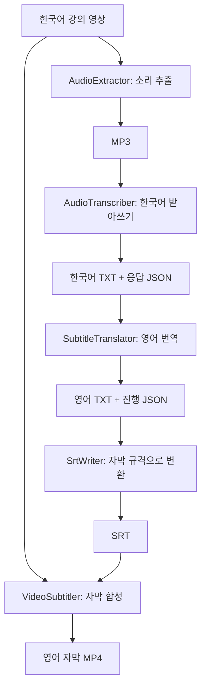

# 한국어 강의 영상에 영어 자막 붙이기 — 개발자를 위한 ELI5

이 프로젝트는 **한국어 강의 영상을 받아 영어 자막이 화면에 표시되는 새 영상을 만드는 Python 프로그램**입니다.

강의를 듣고 받아쓰는 사람, 영어로 옮기는 사람, 영상에 글자를 붙이는 사람이 차례로 일한다고 생각하면 됩니다. Python은 순서를 정하고 파일을 전달합니다. 받아쓰기와 번역은 OpenAI API가, 소리 추출과 영상 합성은 FFmpeg가 담당합니다.

이 문서는 쉬운 비유에서 시작해 실제 클래스와 함수까지 연결합니다. 이전 README는 [README.backup.md](README.backup.md)에 보관했습니다.

## 1. 전체 그림부터 보기



**전사**는 들리는 말을 같은 언어로 받아쓰는 일입니다. **번역**은 그 글을 다른 언어로 옮기는 일입니다. **렌더링**은 여기서 자막 글자를 영상 화면에 그려 새 MP4를 만드는 일입니다.

| 순서 | 쉬운 설명 | 실제 함수 | 실행 장소 |
| --- | --- | --- | --- |
| 1 | 영상에서 소리만 꺼낸다 | `AudioExtractor.extract()` | 내 컴퓨터의 FFmpeg |
| 2 | 한국어를 듣고 시간과 함께 적는다 | `AudioTranscriber.transcribe()` | OpenAI API, 코드상 모델 `whisper-1` |
| 3 | 시간표는 두고 문장만 영어로 옮긴다 | `SubtitleTranslator.translate()` | OpenAI API, 코드상 모델 `gpt-4.1` |
| 4 | 글을 자막 규격에 맞춰 정리한다 | `SrtWriter.write()` | 내 컴퓨터 |
| 5 | 원본 영상에 자막을 붙인다 | `VideoSubtitler.render()` | 내 컴퓨터의 FFmpeg |

전사에는 음성과 텍스트북에서 만든 힌트를, 번역에는 자막 텍스트와 번역 규칙·용어를 전송합니다. 두 단계는 유료 API를 사용합니다. 결과 영상의 자막은 화면에 합성되어 항상 보입니다.

## 2. 처음 실행하기

아래 명령은 Windows PowerShell에서 프로젝트 폴더를 기준으로 실행합니다.

### Python과 패키지 준비

Python 3.10 이상과 Miniconda의 **`translator` 환경**을 사용합니다. 모든 실행·테스트·패키지 설치에 다음 인터프리터를 사용합니다.

```powershell
Set-Location 'D:\VideoSubsribProject'
& 'D:\Miniconda3\envs\translator\python.exe' -m pip install -r requirements.txt
& 'D:\Miniconda3\envs\translator\python.exe' __main__.py --help
```

인터프리터가 없다면 먼저 `translator` 환경을 준비해야 합니다. 프로젝트에서는 `.venv`나 Miniconda base 환경을 사용하지 않습니다.

| 패키지 | 맡은 일 |
| --- | --- |
| `imageio-ffmpeg` | 시스템에 FFmpeg가 없을 때 사용할 실행 파일 제공 |
| `mutagen` | MP3의 길이, 비트레이트 등 정보 읽기 |
| `openai` | 전사·번역 API 요청 |
| `PyQt6` | 영상 플레이어와 텍스트북 편집기 화면 |

FFmpeg는 영상·소리를 변환하는 별도 프로그램입니다. `ffmpeg_tools.py`는 PATH의 `ffmpeg`를 먼저 찾고, 없으면 `imageio-ffmpeg`의 실행 파일을 사용합니다. 자막 합성에는 `subtitles` 필터(libass 지원)가 필요합니다.

### API 키와 텍스트북 준비

프로젝트 안에 다음 두 UTF-8 파일을 만듭니다.

```text
secrets/
├── openai_api_key.txt   # API 키만 한 줄로 입력
└── textbook.txt         # 강의 용어와 작업 규칙
```

`secrets/`는 Git 추적에서 제외됩니다. 새로 내려받은 프로젝트에서는 직접 준비해야 합니다. 키는 `api_config.load_api_key()`가 파일에서 읽습니다.

`textbook.txt`에는 우선 아래 예제를 넣을 수 있습니다.

```text
[Common Rules]
Preserve technical terminology and meaning.

[Whisper Rules]
한국어 회로 강의. 전압, 전류, 직렬저항회로.

[Translation Rules]
Translate Korean lecture speech into natural English subtitles.
Do not summarize or omit technical meaning.

[Course]
회로 (Circuits)

[Terminology]
전압 = voltage
전류 = current
직렬저항회로 = series resistor circuit
```

### 영상 하나로 전체 실행

```powershell
& 'D:\Miniconda3\envs\translator\python.exe' __main__.py 'D:\videos\lecture_kr.mp4'
```

**작업 옵션을 생략하면 전체 5단계가 실행됩니다.** `--pipeline`을 붙여도 같습니다. 콘솔에 현재 단계와 결과 경로가 표시됩니다.

```text
output_runs/
└── lecture_kr-고유문자열/
    ├── audio/
    │   └── lecture_kr.mp3
    ├── transcripts/
    │   ├── lecture_kr.txt              # 한국어 받아쓰기
    │   ├── lecture_kr.json             # 전사 API 원본 응답
    │   ├── lecture_en.txt              # 영어 번역
    │   └── lecture_en.translation.json # 번역 진행 기록
    ├── lecture_en.srt                  # 자막 파일
    └── lecture_en.mp4                  # 최종 영상
```

매번 새 폴더를 만들고 원본 영상을 보존합니다. 입력 이름 끝의 `_kr`·`_ko`는 영어 결과에서 `_en`으로 바뀝니다. 그 외 일반적인 이름에는 `_en`을 덧붙입니다.

결과 폴더의 상위 위치는 `--pipeline-output-dir 'D:\results'`로 지정합니다. 전체 실행의 저장 위치는 이 옵션으로 정합니다.

## 3. 코드에서는 어떤 일이 일어날까?

### 입구와 작업 반장: `__main__.py`, `pipeline.py`

`__main__.py`의 `main()`은 명령줄을 읽는 안내 데스크입니다. 경로와 옵션을 보고 전체 작업 또는 개별 작업을 선택합니다. 작업 옵션은 한 번에 하나만 사용할 수 있습니다.

`pipeline.py`의 `run_pipeline()`은 작업 반장입니다. 입력 영상과 설정을 확인하고 실행 폴더를 만든 다음, 다음 순서로 결과를 전달합니다.

```python
# 실제 호출 관계를 간단히 표현한 의사 코드입니다.
audio = extractor.extract(video)
transcript = transcriber.transcribe(audio)
english_txt = translator.translate(transcript.file_path)
srt = srt_writer.write(english_txt, srt_path)
result = subtitler.render(video.file_path, srt, output_path)
```

각 담당자는 자기 단계만 처리합니다. 중간에 오류가 나면 다음 단계로 넘어가지 않고 완료된 파일은 남겨 둡니다. CLI는 성공 시 `0`, 처리한 작업 오류 시 `1`을 반환합니다.

### 1단계: `audio_extractor.py` — 소리만 담은 작은 파일 만들기

`AudioExtractor.extract()`는 FFmpeg를 실행해 첫 번째 오디오 트랙을 MP3로 저장합니다. 기본 설정은 **모노, 16kHz, 32kbps**입니다. 음성 전송용으로 크기를 줄이므로 음질과 채널 정보가 줄어듭니다.

임시 폴더에서 변환을 마친 뒤 최종 경로로 복사합니다. `mutagen`으로 MP3 정보를 읽어 `AudioFile` 객체를 반환합니다.

`AudioFile`은 **파일 위치와 설명이 적힌 카드**입니다. 실제 소리는 디스크의 MP3에 있고, 객체에는 경로·재생 시간·샘플레이트·채널·비트레이트·용량 등이 담깁니다.

### 2단계: `audio_transcriber.py` — 시간표가 붙은 받아쓰기

`AudioTranscriber.transcribe()`는 MP3와 텍스트북 힌트를 API에 보냅니다. 코드에서는 한국어(`ko`), `verbose_json`, 구간 단위 타임스탬프(`segment`)를 요청합니다.

응답의 각 구간은 “언제 시작했는지, 언제 끝났는지, 무슨 말을 했는지”를 갖습니다. API 원본 응답을 JSON으로 먼저 보관하고, `TranscriptWriter`가 읽기 쉬운 TXT를 만듭니다.

```text
[00:00:01.200, 00:00:04.560] 전압을 측정합니다.
```

이 한 줄은 “1.2초부터 4.56초까지 이 문장을 보여 달라”는 뜻입니다. 현재는 단어별 시간 대신 음성 구간별 시간을 사용합니다.

### 3단계: `subtitle_translator.py` — 시간은 유지하고 말만 바꾸기

`TranscriptReader`가 TXT를 읽으면 시간 표기와 본문이 분리됩니다. 번역기는 구간마다 번호를 붙여 API에 보내고 같은 번호의 영어 문장을 돌려받습니다.

```text
입력: [00:00:01.200, 00:00:04.560] 전압을 측정합니다.
출력: [00:00:01.200, 00:00:04.560] Measure the voltage.
```

원래 시간 표기는 Python 코드가 그대로 붙입니다. 응답의 번호가 빠지거나 추가되었는지 검사하고, 응답 순서와 관계없이 원래 구간 순서로 저장합니다.

한 번에 최대 50구간을 요청하고 앞뒤 3구간을 문맥으로 제공합니다. 빈 번역이 있으면 해당 구간만 최대 2회 추가 요청합니다. 그래도 비어 있으면 오류로 중단합니다.

진행 기록은 게임의 저장 지점과 같습니다. `*.translation.json`에 완료 구간(`segments`)과 아직 묶음 전체가 끝나지 않은 정상 번역(`pending`)을 보관합니다. 같은 출력 경로로 다시 실행하면 저장된 번역을 재사용합니다.

기록의 `fingerprint`는 입력 자막·모델·번역 지시문의 조합을 해시로 요약한 값입니다. 이 값이 달라지면 이전 작업을 섞지 않도록 중단하고 새 출력 경로를 요구합니다.

### 4단계: `srt_writer.py` — 자막 플레이어가 읽는 양식으로 바꾸기

`SrtWriter.write()`는 TXT를 SRT 형식으로 바꿉니다. 번호를 붙이고 시간의 소수점을 쉼표로 바꾸며, 시작과 끝 사이에 `-->`를 넣습니다.

```srt
1
00:00:01,200 --> 00:00:04,560
Measure the voltage.
```

번역이나 시간 재계산은 하지 않습니다. 긴 본문은 64자 폭을 기준으로 줄바꿈합니다.

### 5단계: `video_subtitler.py` — 영상 화면에 글자 그리기

`VideoSubtitler.render()`는 원본 영상과 SRT를 FFmpeg에 전달합니다. 첫 번째 영상 트랙과 첫 번째 오디오 트랙(있는 경우)을 사용하고, H.264 영상과 AAC 음성으로 다시 인코딩합니다.

자막은 화면에 직접 그려집니다. 글꼴·크기·테두리·아래 여백은 이 파일의 `force_style` 설정에 있습니다. 임시 영상 생성이 성공해야 최종 MP4로 복사합니다.

## 4. 데이터 모델을 읽는 방법

`dataclass`는 여러 값을 한 묶음으로 보관하는 Python의 편의 기능입니다. 여기서는 “파일 정보”, “자막 한 줄”, “과목” 같은 묶음에 사용합니다.

| 모델 | 담고 있는 것 | 쓰이는 곳 |
| --- | --- | --- |
| `MediaFile` / `VideoFile` | 절대 파일 경로와 연결된 자막 목록 | 파일 전달의 기본 단위 |
| `AudioFile` | 파일 경로 + 음성 길이·용량·형식 등 | 추출 결과 |
| `SubscriptFile` | 파일 경로 + `SubscriptLine` 목록 | 전사 결과 |
| `SubscriptLine` | 본문, 시작·종료 `TimeStamp` | 전사 응답을 자막으로 변환 |
| `TimeStamp` | 시·분·초·밀리초 | 자막 시간 표현 |
| `SubtitleTextLine` | 원래 시간 문자열 + 본문 | TXT 읽기, 번역, SRT 생성 |
| `Course` / `Textbook` | 과목명·용어 대응표 / 과목 목록·규칙 | 전사·번역의 참고 자료 |

코드의 `SubscriptFile`, `SubscriptLine`은 자막 관련 이름입니다. 검색하거나 수정할 때는 이 실제 철자를 사용하면 됩니다.

전사 단계는 API가 준 초 값을 `TimeStamp`로 바꿉니다. 번역 단계는 이미 만들어진 시간을 보존해야 하므로 시간 문자열을 담는 `SubtitleTextLine`을 사용합니다.

## 5. 텍스트북은 AI에게 건네는 강의 메모

텍스트북은 **이번 강의의 용어와 작업 규칙을 적은 설정 파일**입니다. `textbook.py`가 이를 읽어 API에 보낼 prompt(참고 문구·지시문)를 만듭니다.

| 섹션 | 쉬운 설명 | 사용 단계 |
| --- | --- | --- |
| `[Common Rules]` | 모두에게 주는 공통 메모 | 전사·번역 |
| `[Whisper Rules]` | 받아쓸 때 참고할 말 | 전사 |
| `[Translation Rules]` | 영어로 옮기는 방법 | 번역, 번역 실행 시 필수 |
| `[Course]` | 강의 이름 | 전사·번역 |
| `[Terminology]` | `한국어 = English` 용어표 | 전사는 한국어 용어, 번역은 한영 대응표 |

여러 과목이 있으면 `[Course]`와 `[Terminology]` 묶음을 반복합니다. 각 과목에는 이름과 한 개 이상의 용어가 필요합니다. 같은 과목 안의 중복 한국어 용어는 오류이고, 서로 다른 과목에는 같은 용어를 다른 뜻으로 등록할 수 있습니다.

규칙 섹션은 종류별로 한 번씩 작성합니다. 섹션 이름은 대소문자를 구분하지 않으며 빈 줄과 `#`으로 시작하는 줄은 무시합니다. 기존 `[Translation instructions]` 이름도 지원합니다.

현재는 파일 안의 **모든 과목**이 prompt에 들어갑니다. 필요한 과목만 넣거나 `--textbook-file 'secrets\circuits.txt'`로 강의별 파일을 지정하세요. 코드는 prompt의 토큰 수를 계산하거나 자동으로 줄이지 않습니다.

## 6. 한 단계씩 실행하고 결과 확인하기

개발 중에는 단계별로 실행하면 어느 부분의 결과가 잘못되었는지 확인하기 쉽습니다. 다음 예제는 `lecture_kr.mp4`를 순서대로 처리합니다.

```powershell
# 1. 영상 → MP3 (로컬)
& 'D:\Miniconda3\envs\translator\python.exe' __main__.py 'D:\videos\lecture_kr.mp4' --extract

# 2. MP3 → 한국어 TXT + JSON (유료 API)
& 'D:\Miniconda3\envs\translator\python.exe' __main__.py 'output_audios\lecture_kr.mp3' --transcribe

# 3. 한국어 TXT → 영어 TXT (유료 API)
& 'D:\Miniconda3\envs\translator\python.exe' __main__.py 'output_txts\lecture_kr.txt' --translate

# 4. 영어 TXT → SRT (로컬)
& 'D:\Miniconda3\envs\translator\python.exe' __main__.py 'output_txts\lecture_en.txt' --make-srt

# 5. 원본 영상 + 영어 TXT → 자막 MP4 (로컬, SRT도 생성)
& 'D:\Miniconda3\envs\translator\python.exe' __main__.py 'D:\videos\lecture_kr.mp4' --render --subtitle-file 'output_txts\lecture_en.txt'
```

| 개별 작업 | 기본 출력 |
| --- | --- |
| `--extract` | `output_audios/lecture_kr.mp3` |
| `--transcribe` | `output_txts/lecture_kr.txt`, `lecture_kr.json` |
| `--translate` | 입력 TXT 옆의 `lecture_en.txt`, `lecture_en.translation.json` |
| `--make-srt` | `output_subtitles/lecture_en.srt` |
| `--render` | `output_subtitles/lecture_en.srt`, `output_videos/lecture_en.mp4` |

기본 출력 폴더와 설정 파일은 프로젝트 위치 기준입니다. 직접 입력한 상대 경로는 명령을 실행한 폴더 기준입니다.

`--transcribe`에 MP3를 주면 그대로 전달하고, 영상이나 WAV를 주면 먼저 MP3를 추출합니다. `--extract`로 기존 WAV를 MP3로 바꾸는 것도 가능합니다.

`--render`의 `--subtitle-file`에는 시간이 붙은 **TXT**를 지정합니다. 코드에 예제용 기본 경로가 있으므로 실제 사용할 파일을 명시하는 편이 분명합니다.

| 옵션 | 바꿀 수 있는 것 |
| --- | --- |
| `--api-key-file` | API 키 파일 위치 |
| `--textbook-file` | 텍스트북 파일 위치 |
| `--pipeline-output-dir` | 전체 실행 결과의 상위 폴더 |
| `--transcript-output-dir` | 개별 전사의 TXT·JSON 저장 폴더 |
| `--translation-output` | 개별 번역의 영어 TXT 경로 |
| `--srt-output` | 개별 SRT 생성·렌더링의 SRT 경로 |
| `--video-output` | 개별 렌더링의 MP4 경로 |

## 7. 멈췄을 때 이어가기

**전체 명령을 다시 실행하면 새 폴더에서 처음부터 시작합니다.** 전체 파이프라인 자체에는 이어하기가 없으며 전사·번역 API 비용이 다시 발생합니다. 완료한 중간 파일을 개별 명령의 입력으로 사용하세요.

예를 들어 번역 중 멈췄다면 콘솔에 출력된 실제 실행 폴더를 사용합니다. 아래의 `실제실행폴더`를 해당 폴더명으로 바꾸세요.

```powershell
& 'D:\Miniconda3\envs\translator\python.exe' __main__.py 'output_runs\실제실행폴더\transcripts\lecture_kr.txt' --translate
```

이 명령은 같은 영어 출력 경로의 진행 JSON을 읽습니다. 완료된 영어 TXT가 이미 있으면 번역 대신 `--render`로 진행하면 됩니다. 자막 TXT의 시간 기준은 원본 영상과 같아야 합니다.

| 상황 | 현재 동작과 대응 |
| --- | --- |
| MP3가 25MB 이상 | 코드가 전사 요청 전에 거부합니다. 자동 분할은 없으므로 먼저 파일을 나눠야 합니다. |
| 결과 파일이 이미 있음 | 일반적으로 덮어쓰지 않습니다. 새 출력 경로를 사용하세요. SRT만 기존 내용이 같으면 재사용합니다. |
| 전사 JSON만 남음 | API 응답은 보관되어 있습니다. TXT 재생성에는 별도 재가공 코드가 필요하며 전용 CLI 옵션은 없습니다. |
| 번역 원문·규칙·모델이 바뀜 | 기존 진행 기록과 맞지 않으면 중단합니다. `--translation-output`으로 새 경로를 지정하세요. |
| 번역 일부가 계속 비어 있음 | 구간 번호·시간·원문을 확인합니다. 정상 번역은 진행 JSON에 보관됩니다. |
| API 연결 또는 인증 실패 | 연결·키 파일·API 사용 한도를 확인합니다. SDK의 자동 재시도는 꺼져 있습니다. |
| 자막 합성 실패 | FFmpeg 오류 메시지와 `subtitles` 필터 지원 여부를 확인합니다. |

전사·번역의 API 대기 중에는 5초마다 상태 메시지가 나오고, 영상 합성 중에는 FFmpeg의 처리 위치가 표시됩니다. 인식 문장, 전문용어, 자막 시간은 결과 파일과 실제 영상을 대조해 검수하세요.

## 8. GUI는 영상 플레이어와 텍스트북 편집기

`qtTest/`라는 폴더 이름이지만 그 안에는 실제 PyQt6 앱 코드가 있습니다. 현재 GUI는 영상 재생·오디오 파형 표시와 텍스트북 편집을 제공합니다. 전체 자막 생성은 위의 CLI로 실행합니다.

```powershell
# 영상 플레이어
& 'D:\Miniconda3\envs\translator\python.exe' -m qtTest.app

# 텍스트북 편집기만 실행
& 'D:\Miniconda3\envs\translator\python.exe' -m qtTest.textbook_editor

# 특정 텍스트북을 열어 실행
& 'D:\Miniconda3\envs\translator\python.exe' -m qtTest.textbook_editor --textbook-file 'secrets\textbook.txt'
```

플레이어에서 `Ctrl+O`로 영상을 열고, `Tools → 텍스트북 편집기` 또는 `Ctrl+Shift+T`로 편집창을 엽니다. 파형을 클릭하면 재생 위치를 이동할 수 있습니다.

편집기에서는 `Open` 또는 `Ctrl+O`로 파일을 열고 규칙을 수정하거나 과목을 추가하고, 한글명·영어명 셀을 편집합니다. `Save` 또는 `Ctrl+S`로 저장합니다. 새 과목에는 단어를 하나 이상 넣어야 하며 빈 셀과 중복 용어는 저장 시 검사합니다.

저장하면 파일을 표준 섹션 형식으로 다시 쓰므로 기존 주석과 공백 배치는 유지하지 않습니다. 다른 파일을 열거나 창을 닫을 때 미저장 내용을 확인합니다.

편집기 코드는 세 역할로 나뉩니다. 아래 파일은 모두 `qtTest/textbook_editor/` 안에 있습니다.

| 파일 | 비유 | 책임 |
| --- | --- | --- |
| `data.py` | 편집 중인 공책과 보관함 | 편집 데이터, 검증, 외부 파일 변경 확인, 임시 파일을 통한 저장 |
| `model.py` | 공책과 표 사이의 연결자 | 과목별 데이터를 Qt 테이블에 연결 |
| `editor.py` | 책상 위 화면 | 버튼, 규칙 입력창, 표, 저장·열기 동작 |

`data.py`는 Qt 없이 데이터와 파일을 다룰 수 있도록 분리되어 있습니다. `qtTest/MyApp.py`는 편집창 열기·재사용·종료를 연결합니다. `qtTest/AudioWaveVisualizer.py`는 별도 작업 스레드에서 파형 데이터를 만들고 화면에 그립니다.

## 9. 개발할 때 어느 파일부터 보면 될까?

처음에는 **`__main__.py` → `pipeline.py` → 관심 있는 단계의 모듈** 순서로 읽으면 됩니다. 전체 호출 관계를 이해한 다음 세부 구현으로 들어갈 수 있습니다.

| 바꾸고 싶은 동작 | 먼저 볼 파일 |
| --- | --- |
| CLI 옵션·기본 출력 경로 | [__main__.py](__main__.py) |
| 전체 작업 순서·실행 폴더 | [pipeline.py](pipeline.py) |
| MP3 음질·샘플레이트·채널 | [audio_extractor.py](audio_extractor.py) |
| 전사 모델·언어·응답 처리 | [audio_transcriber.py](audio_transcriber.py) |
| 번역 모델·묶음 크기·재요청·이어하기 | [subtitle_translator.py](subtitle_translator.py) |
| 강의 용어·일반 작업 규칙 | 로컬 `secrets/textbook.txt` |
| 텍스트북 형식·prompt 구성 | [textbook.py](textbook.py) |
| 자막 TXT 읽기·쓰기 | [transcript_reader.py](transcript_reader.py), [transcript_writer.py](transcript_writer.py) |
| 파일·자막 데이터 구조 | [media_file.py](media_file.py), [subtitle.py](subtitle.py) |
| SRT 줄바꿈·출력 형식 | [srt_writer.py](srt_writer.py) |
| 자막 모양·영상 인코딩 | [video_subtitler.py](video_subtitler.py) |
| FFmpeg 탐색·API 키 읽기·대기 표시 | [ffmpeg_tools.py](ffmpeg_tools.py), [api_config.py](api_config.py), [console_status.py](console_status.py) |
| GUI 시작·메뉴·영상 재생 | [qtTest/app.py](qtTest/app.py), [qtTest/MyApp.py](qtTest/MyApp.py), [qtTest/videoPlayer.py](qtTest/videoPlayer.py) |
| 텍스트북 편집 화면 | [qtTest/textbook_editor/editor.py](qtTest/textbook_editor/editor.py) |

루트의 `OpenAITranscriber.py`에는 `opeanai` import 오타 등이 있는 미완성 코드가 남아 있습니다. 현재 CLI·파이프라인이 사용하는 전사 구현은 **`audio_transcriber.py`의 `AudioTranscriber`**입니다.

자동 음성 분할, 전체 파이프라인 이어하기, 텍스트북 라이브러리 선택·영상별 과목 연결은 현재 구현되어 있지 않습니다.

## 10. 테스트로 코드의 약속 확인하기

```powershell
& 'D:\Miniconda3\envs\translator\python.exe' -m unittest discover -s tests -v
```

테스트는 “이 입력을 넣으면 이런 결과가 나와야 한다”는 실행 가능한 예제입니다. 기존 테스트는 API 요청과 무거운 처리 단계를 가짜 응답·대역으로 바꿔 검증합니다. 실제 유료 API를 호출하지 않습니다.

| 테스트 파일 | 확인하는 약속 |
| --- | --- |
| `test_pipeline.py` | 단계 사이 파일 전달, 실행별 폴더 분리, 실패 시 후속 단계 중단 |
| `test_transcription.py` | 전사 요청 형식, 시간 포함 TXT 저장, 키·용량·응답 오류 처리 |
| `test_textbook.py` | 과목·규칙 파싱, 전사와 번역에 맞는 규칙 전달 |
| `test_textbook_editor.py` | 편집·저장, 입력 검증, 저장 실패 시 기존 파일 보존 |
| `test_textbook_main.py` | 메뉴에서 편집창 재사용, 미저장 내용이 있는 상태의 종료 처리 |

이 테스트만으로 실제 음성 인식·번역 품질이나 FFmpeg의 최종 영상 결과까지 확인되는 것은 아닙니다. 해당 부분을 수정했다면 짧은 샘플 영상으로 관련 단계를 실행해 결과도 확인하세요.
