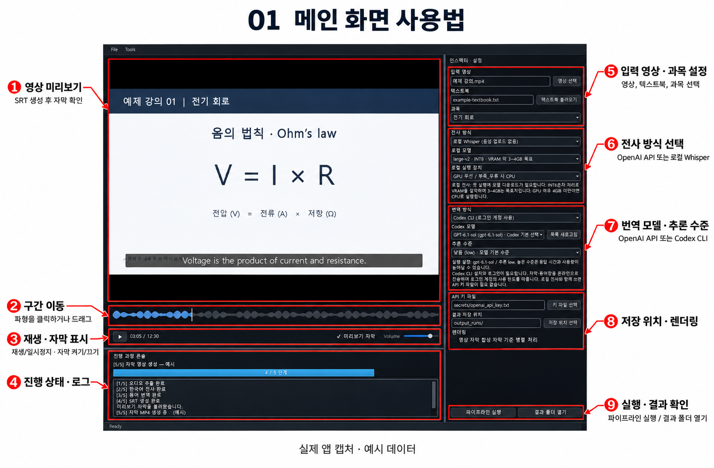
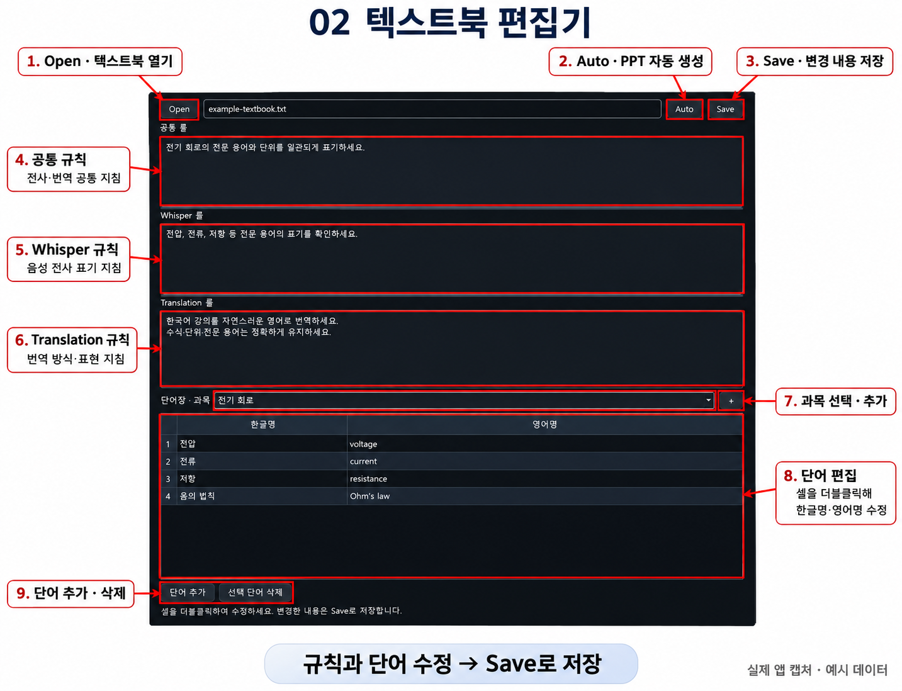
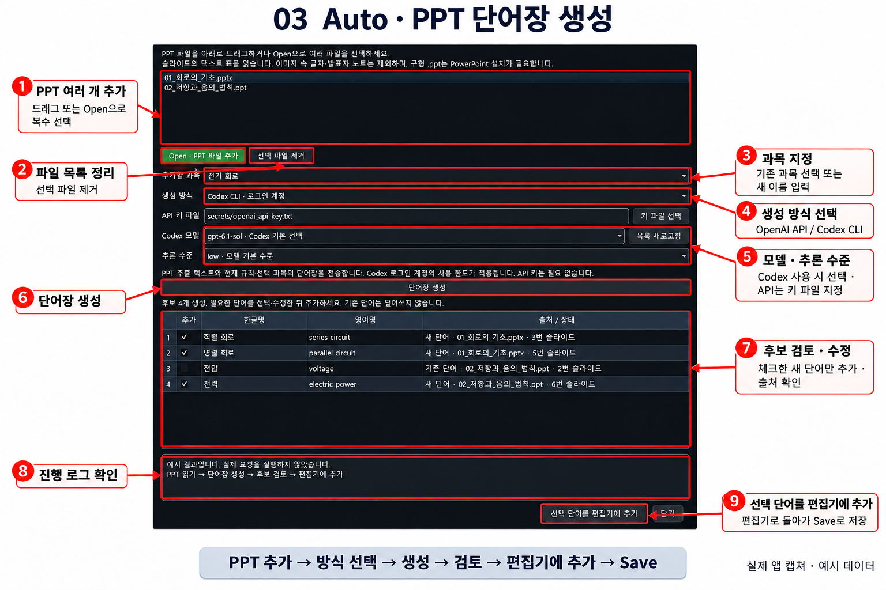

# Video Subtitle Translator 화면별 사용법

영상에 자막을 만드는 메인 화면, 텍스트북 편집기, PPT 단어장 자동 생성 창의 사용법입니다. 붉은 테두리는 조작 영역이고 화살표 옆 글씨는 기능명입니다. 이미지를 클릭하면 크게 볼 수 있습니다.

- [메인 화면](#메인-화면)
- [텍스트북 편집기](#텍스트북-편집기)
- [Auto PPT 단어장 생성](#auto-ppt-단어장-생성)
- [Codex CLI 설치 및 로그인](../../README.md#codex-cli-설치-및-로그인-windows)
- [오프라인 안내 ZIP 다운로드](../user-guide.zip?raw=true): 압축을 풀고 `index.html`을 브라우저로 여세요.

2026-11-12 버전의 실제 Qt 화면을 예시 자료로 캡처했습니다. 진행 상태·생성 결과·모델 선택은 사용법 설명용 예시입니다. 붉은 박스·화살표 주석은 Imagegen으로 제작했으며 각 화면 아래에서 원본 캡처도 볼 수 있습니다.

## 메인 화면

**영상 선택 → 텍스트북 불러오기 → 과목 선택 → 전사·번역 방식 설정 → 파이프라인 실행**

1. 오른쪽에서 영상, 텍스트북 파일과 사용할 과목을 선택합니다.
2. 전사는 **OpenAI API / 로컬 Whisper**, 번역은 **OpenAI API / Codex CLI** 중 선택합니다. Codex는 모델과 추론 수준도 선택합니다.
3. API를 사용하는 경우 키 파일을 지정합니다. 저장 위치와 병렬 렌더링 옵션을 확인한 뒤 **파이프라인 실행**을 누릅니다.
4. 진행 상태는 왼쪽 아래 콘솔에서 확인합니다. SRT 생성 후에는 인코딩 중에도 미리보기 자막을 볼 수 있습니다.
5. 파형 클릭·드래그로 구간을 이동하고 **미리보기 자막** 체크박스로 표시를 켜고 끕니다. 완료 후 **결과 폴더 열기**에서 SRT와 MP4를 확인합니다.

영상·콘솔과 설정창 사이의 경계선을 드래그하면 영역 크기를 조절할 수 있습니다. 텍스트북 편집기는 **Tools → 텍스트북 편집기** 또는 **Ctrl+Shift+T**로 엽니다.

[주석 없는 메인 화면 원본 캡처](raw/01-main.png)

## 텍스트북 편집기

**Open → 규칙·과목·단어 편집 → Save**

1. **Open**으로 텍스트북 TXT를 엽니다. 새 파일은 규칙·과목·단어를 작성한 후 Save에서 저장 위치를 지정합니다.
2. **공통 룰**은 공통 지침, **Whisper 룰**은 전사 지침, **Translation 룰**은 번역 지침입니다.
3. 과목을 선택하거나 **+**로 새 과목을 추가합니다. 단어 셀을 더블클릭해 한글명과 영어명을 수정합니다.
4. **단어 추가**로 행을 만들고, 행을 선택한 뒤 **선택 단어 삭제**로 제거합니다.
5. **Auto**는 PPT 자동 단어장 생성 창을 엽니다. 직접 편집하거나 Auto로 추가한 내용은 **Save**로 저장해야 파일에 반영됩니다.

[주석 없는 텍스트북 편집기 원본 캡처](raw/02-textbook.png)

## Auto PPT 단어장 생성

**PPT 추가 → 과목·생성 방식 선택 → 생성 → 검토·수정 → 편집기에 추가 → Save**

1. PPT/PPTX 여러 개를 목록으로 드래그하거나 **Open · PPT 파일 추가**로 선택합니다. 불필요한 파일은 선택 후 제거합니다.
2. 기존 과목을 선택하거나 새 과목명을 입력합니다. 선택한 파일들은 한 과목의 단어장으로 모입니다.
3. **OpenAI API**는 API 키 파일을 지정하고, **Codex CLI**는 로그인 계정의 모델과 추론 수준을 선택합니다.
4. **단어장 생성**을 누르고 진행 로그를 확인합니다. 현재 규칙·기존 단어를 참고해 후보를 생성합니다.
5. 후보의 한글명·영어명을 수정하고 필요한 단어만 체크합니다. 출처는 오른쪽 열에서 확인하며, 긴 내용은 마우스를 올려 봅니다. 기존 단어와 충돌 후보는 기본 선택에서 제외됩니다.
6. **선택 단어를 편집기에 추가**를 누른 뒤 편집기로 돌아가 **Save**로 저장합니다. Auto 창의 추가 버튼 자체는 파일을 저장하지 않습니다.

PPTX는 직접 읽으며 구형 PPT에는 설치된 PowerPoint가 필요합니다. 이미지 속 글자(OCR)와 발표자 노트는 추출하지 않습니다. 생성 시 추출 텍스트와 규칙·기존 단어를 선택한 서비스에 전송하며 API 요금 또는 Codex 계정의 사용 한도가 적용됩니다.

[주석 없는 Auto 다이얼로그 원본 캡처](raw/03-auto.png)

---

[프로젝트 README](../../README.md) · [예제 텍스트북](example-textbook.txt) · [캡처 생성 코드](../capture_user_guide.py) · [주석 생성 프롬프트](annotation-prompts.json)
